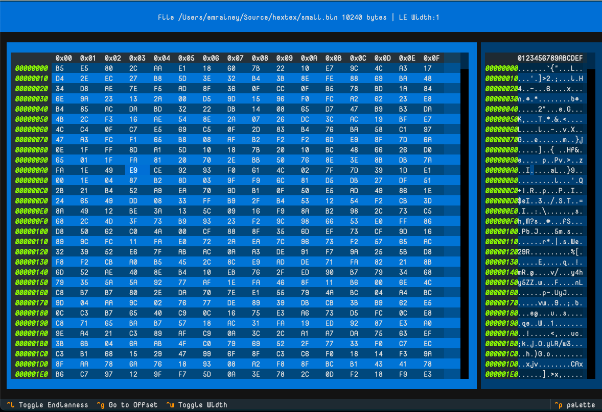

# HexTex

The Hex Viewer/Editor in Textual

## Keys

* Use `Ctrl+w` to change the display width of the units (1, 2, 4, or 8 bytes)
* Use `Ctrl+l` to toggle the display endianness of the units (little/big endian)
* Use `Ctrl+g` to go to an offset in the file
* Use `e` to edit the currently selected cell value
* Use `Ctrl+s` to save changes to the file

## Features

* **Multi-width Display**: View data as bytes, words, dwords, or qwords
* **Endianness Toggle**: Switch between little-endian and big-endian representations
* **Hex Editing**: Edit cell values directly with hex input validation
* **Synchronized Views**: Hex and ASCII views stay in sync as you navigate
* **Modified Indicator**: Status bar shows when file has unsaved changes
* **Safe Editing**: Modal dialog with input validation prevents invalid hex values

## Issues

* On occasion, the synchronization between the two data tables will cause a fast flickering between two locations as the highlight updates between two coordinates. Sometimes this can be resolved by using the `Ctrl+g` to go to a specific offset, like 0.
